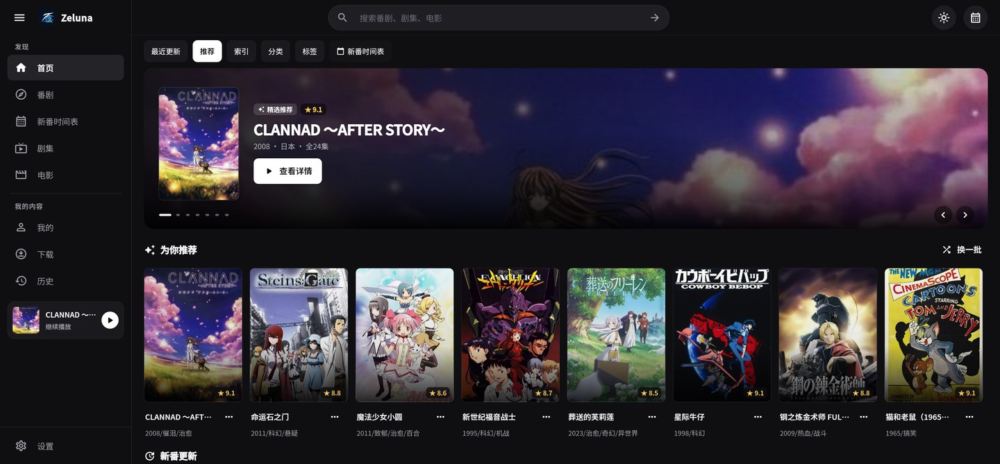
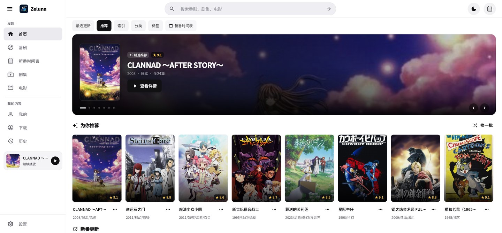
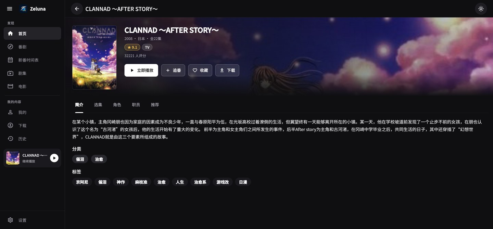
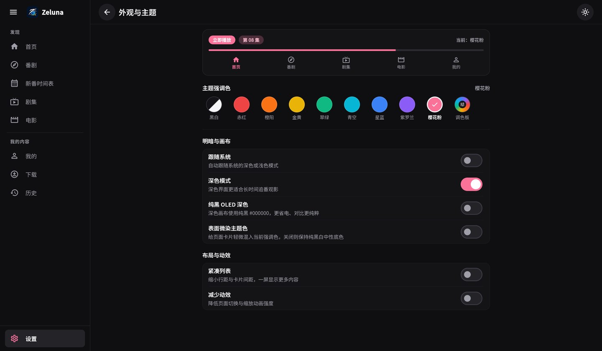
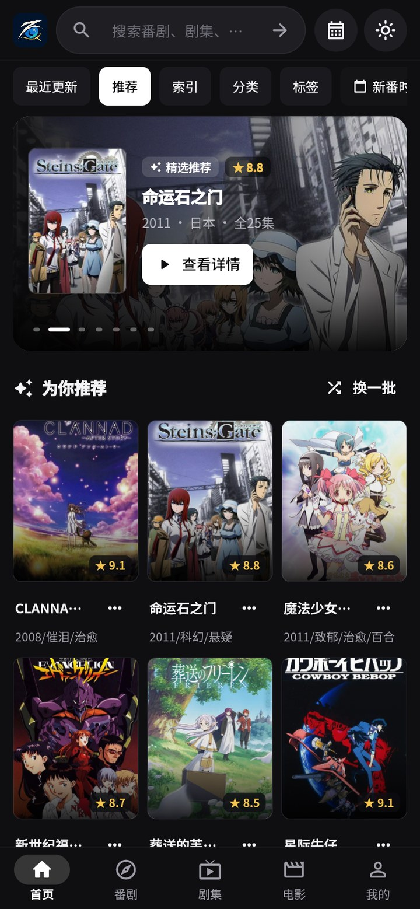

<div align="center">


<h1>Zeluna</h1>

<p>跨平台番剧、剧集与电影播放器，支持多源聚合、弹幕、Anime4K 实时超分辨率与跨设备云同步。</p>

[](https://github.com/fanyong07/Zeluna/releases/latest)
[](https://github.com/fanyong07/Zeluna/stargazers)
[](https://github.com/fanyong07/Zeluna/releases)
[](https://flutter.dev)
[](LICENSE)

[立即下载](https://github.com/fanyong07/Zeluna/releases/latest) · [下载与平台](#下载与支持平台) · [界面预览](#界面预览) · [主要功能](#主要功能) · [免责声明](#免责声明)

</div>

---

## 下载与支持平台

前往 [Releases 页面](https://github.com/fanyong07/Zeluna/releases/latest) 下载最新版本安装包：

| 平台 | 说明 |
| --- | --- |
| **Android** | Android 7.0 及以上，下载 `Zeluna-vX.Y.Z-Android.apk` 直接安装，支持应用内检查更新 |
| **Windows** | Windows 10 / 11（x64），下载 `Zeluna-vX.Y.Z-Windows.zip` 解压后运行 `Zeluna.exe` |
| **Web** | 支持自行构建并部署至 HTTPS 站点 |

---

## 界面预览

<table>
  <tr>
    <td></td>
    <td></td>
  </tr>
  <tr>
    <td></td>
    <td></td>
  </tr>
</table>

<div align="center">
  
</div>

---

## 主要功能

- [x] 番剧、电视剧、电影分频道浏览、搜索与新番时间表
- [x] 多线路聚合播放，支持自动择优、换线与广告线路降权
- [x] 实时弹幕支持（接入 [弹弹play](https://www.dandanplay.com/) 开放弹幕网络）与外挂字幕
- [x] 基于 [Anime4K](https://github.com/bloc97/Anime4K) 的实时视频超分辨率
- [x] 多套强调色与自定义调色板、深浅色水波切换与 OLED 纯黑模式
- [x] 追番管理、收藏、观看历史与跨设备云同步
- [x] 离线缓存下载（常规直链与未加密 HLS）
- [x] 私有媒体库接入（Emby / Jellyfin / WebDAV / Alist）
- [x] 支持自定义扩展播放规则
- [x] 倍速播放、移动端手势控制与桌面端鼠标/快捷键操控
- [x] Android 应用内检查更新与校验安装
- [ ] 无线投屏（DLNA / AirPlay）
- [ ] 更多功能与平台适配持续开发中

---

## 从源码构建

<details>
<summary>展开查看 Flutter 客户端本地运行与测试说明</summary>

```bash
flutter pub get
flutter run -d windows
```

运行验证：

```bash
flutter analyze
flutter test
```

</details>

---

## 免责声明

- 本项目仅作为跨平台媒体信息浏览与视频播放客户端使用，不提供、不存储、不分发任何视频文件或受版权保护的媒体内容。
- 作品资料来自 Bangumi、TMDB 等公开接口，弹幕来自弹弹play等第三方开放网络，所有第三方内容权利均归原权利人所有。
- 请仅添加与观看您有权访问的媒体来源；如涉及版权或合规问题，请及时联系处理。

---

## 许可证

本项目代码采用 [Apache License 2.0](LICENSE) 开源许可。第三方依赖、字体与着色器资源继续适用各自许可证，详见 [`THIRD_PARTY_NOTICES.md`](THIRD_PARTY_NOTICES.md)。
